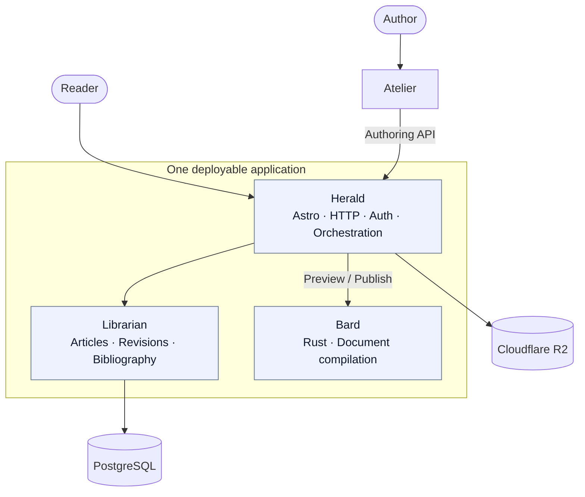
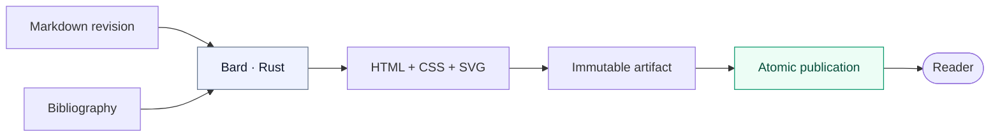

# miguel's blog

A personal publishing system for technical articles and essays.  

The project prioritizes public reading performance, reproducible document compilation, and immutable revision history. It is designed as a single deployable application with distinct internal components.

## Architecture

| Component | Purpose |
|:--|:--|
| **Bard** | Compiles Markdown, IEEE-default CSL citations, and diagrams into styled HTML and static assets. |
| **Librarian** | Owns articles, bibliography, immutable revisions, artifacts, and publication state. |
| **Atelier** | Private Markdown-first writing and preview interface. |
| **Herald** | Serves the site, authenticates the author, and coordinates publication. |

### Publication model

Math, syntax highlighting, Mermaid diagrams, citations, and article styling are compiled before publication. Public requests retrieve compiled HTML and static assets; they do not invoke Bard.

## Technology stack

| Layer | Planned technology |
|:--|:--|
| Public site & server | **Astro SSR**, TypeScript, Node.js |
| Authoring | **Svelte**, **CodeMirror 6** |
| Document compiler | **Rust**, `comrak`, `mermaid-rs-renderer` |
| Content persistence | **PostgreSQL**, Kysely |
| Media & generated assets | **Cloudflare R2** |
| Deployment | **Docker**, one application container |

## Design principles

- **Public reading performance.** Minimal browser JavaScript; no compilation on public requests.
- **Immutable history.** Revisions and compiled artifacts are append-only; publication advances an atomic pointer.
- **Modular monolith.** Components communicate through explicit contracts, not separate services.

## Roadmap

- [ ] **01 · Bard — compiler foundation:** Rust CLI and library, GFM parsing, diagnostics, and versioned compilation contract.
- [ ] **02 · Bard — complete rendering:** Pre-render math, syntax highlighting, Pandoc-style citations, Mermaid SVG, and article CSS; validate output safety.
- [ ] **03 · Librarian — content model:** PostgreSQL schema, bibliography, immutable revisions, and artifact records.
- [ ] **04 · Herald — publication pipeline:** Invoke Bard, store generated assets in R2, and publish atomically.
- [ ] **05 · Herald — public reading:** Astro article pages, localized routes, caching, SEO, feeds, and sitemap.
- [ ] **06 · Atelier — authoring:** Markdown editor, preview, metadata, bibliography, revision history, and publication controls.
- [ ] **07 · Release hardening:** GitHub OAuth allowlist, integration tests, performance benchmarks, backups, and Docker deployment
