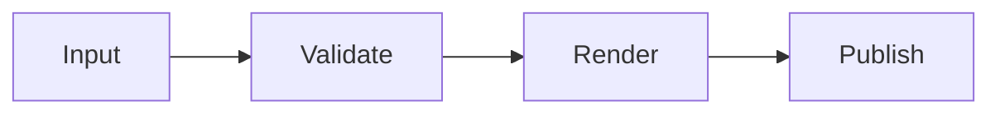

# Building reliable software systems

A compiler should turn a reviewed source snapshot into safe static output. Rust makes ownership and error handling visible at the boundaries, while reproducible inputs keep the rendered document suitable for caching and publication.

The engineering process combines clear interfaces, focused tests, and careful review. A small implementation can still support rich content: tables, citations, formulas, highlighted code, and diagrams all have stable output contracts.

| Concern | Treatment | Outcome |
| --- | --- | --- |
| References | CSL JSON snapshots and IEEE style | Reproducible citations |
| Mathematics | MathML Core | Accessible formulas |
| Diagrams | Sanitized SVG assets | Static publication |

The equation $E = mc^2$ is inline. A second expression follows:

$$
\sum_{i=1}^{n} i = \frac{n(n+1)}{2}
$$

A citation cluster connects prior work [@rust-book, pp. 10-12; @rust-paper].

```rust
fn compile(source: &str) -> Result<String, Error> {
    validate(source)?;
    render(source)
}
```



## Review checklist

- [x] Validate content before rendering
- [x] Preserve source positions for diagnostics
- [ ] Compare generated output against a golden fixture

A predictable build makes it easier to review changes, identify regressions, and publish content confidently. Unicode such as São Paulo, ação, and 日本語 should remain intact through the pipeline.
